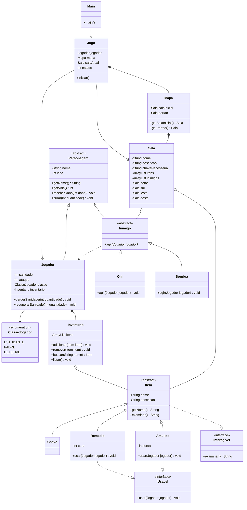

# Castle Gwyindolin

**Castle Gwyindolin** é um jogo de terror psicológico em modo texto, desenvolvido em Java para a disciplina de Programação Orientada a Objetos (POO).

O jogo é inspirado em RPGs de terror, especialmente títulos como *Ao Oni*, *Mogeko Castle* e *Yume Nikki*. Em vez de gráficos e animações, a experiência acontece pelo console, com exploração de ambientes, encontros com inimigos, coleta de itens e decisões que podem influenciar o final da história.

## Sobre o jogo

O jogador acorda em um casarão misterioso sem saber exatamente como chegou ali. Para escapar, precisa explorar os cômodos, encontrar chaves e lidar com as criaturas que habitam o lugar.

Mas não basta apenas encontrar a saída. A sanidade também precisa ser preservada durante a exploração, já que permanecer naquele ambiente pode ser tão perigoso quanto enfrentar os inimigos.

## Objetivo

O principal objetivo é encontrar a chave do portão e escapar do casarão.

Para isso, o jogador precisa:

- Explorar os cômodos disponíveis.
- Encontrar a chave do porão na cozinha.
- Entrar no porão e conseguir a chave final.
- Chegar ao portão e tentar escapar com vida e sanidade suficientes.

As escolhas durante a partida influenciam as condições em que o jogador termina a história.

## Como jogar

O jogo funciona por meio de um menu apresentado no console. Cada opção permite realizar uma ação diferente.

| Opção | Ação |
|---|---|
| 1 | Movimentar-se entre os cômodos |
| 2 | Pegar um item |
| 3 | Usar um item do inventário |
| 4 | Examinar um item |
| 5 | Consultar o inventário |
| 6 | Ver o status do personagem |
| 7 | Observar o cômodo atual |
| 8 | Atacar um inimigo |
| 0 | Encerrar o jogo |

Algumas ações fazem o tempo passar. Quando isso acontece, os inimigos presentes no cômodo podem agir e a sanidade do jogador diminui. Por isso, é importante pensar antes de agir e administrar os recursos disponíveis.

## Mapa do casarão

O mapa é formado por cinco cômodos conectados entre si:

- **Quarto:** local onde a exploração começa. É possível encontrar uma bandagem.
- **Corredor:** conecta os principais ambientes do casarão.
- **Cozinha:** contém a chave do porão, um amuleto e uma Sombra.
- **Porão:** área bloqueada inicialmente, onde estão a chave final e um Oni.
- **Portão:** saída do casarão, que só pode ser aberta com a chave final.

A progressão depende da exploração e da obtenção das chaves necessárias para acessar as áreas bloqueadas.

## Classes de personagem

No início da partida, o jogador escolhe uma das três classes disponíveis. Cada uma possui atributos próprios, oferecendo diferentes condições para enfrentar os desafios.

| Classe | Vida inicial | Sanidade inicial | Ataque |
|---|---:|---:|---:|
| Estudante | 85 | 85 | 15 |
| Padre | 70 | 100 | 10 |
| Detetive | 100 | 70 | 20 |

A escolha influencia a maneira como o jogador pode lidar com os inimigos e com os perigos do casarão.

## Itens e inimigos

### Itens

- **Bandagem:** recupera 30 pontos de vida.
- **Amuleto:** recupera 25 pontos de sanidade.
- **Chaves:** permitem acessar áreas bloqueadas e avançar na exploração.

Os itens podem ser encontrados nos cômodos e armazenados no inventário. Alguns podem ser usados diretamente pelo jogador, enquanto outros servem para liberar caminhos.

### Inimigos

- **Oni:** possui 30 pontos de vida e causa 20 pontos de dano ao jogador quando age.
- **Sombra:** possui 20 pontos de vida e reduz a sanidade do jogador em 10 pontos quando age.

Além dos efeitos dos inimigos, a passagem de um turno também reduz a sanidade em 2 pontos. Se a vida ou a sanidade chegar a zero, a partida termina.

## Finais

O final depende da sanidade restante quando o jogador consegue chegar ao portão e concluir a fuga.

- **Final bom:** sanidade igual ou superior a 50.
- **Final normal:** sanidade entre 25 e 49.
- **Final ruim:** sanidade inferior a 25.

Dessa forma, sobreviver aos confrontos não é suficiente: administrar a sanidade também faz parte do objetivo.

## Estrutura do projeto

O projeto foi organizado em classes com responsabilidades diferentes, evitando concentrar toda a lógica do jogo em um único arquivo.

| Classe ou interface | Responsabilidade |
|---|---|
| `Main` | Ponto de entrada do programa. |
| `Jogo` | Controla o andamento da partida, o menu, as ações e as condições de encerramento. |
| `Mapa` | Cria os cômodos, suas conexões, os itens e os inimigos. |
| `Sala` | Representa cada cômodo e mantém suas conexões, itens, inimigos e bloqueios. |
| `Personagem` | Classe abstrata com os atributos e comportamentos básicos de um personagem. |
| `Jogador` | Representa o personagem controlado pelo usuário, incluindo vida, sanidade, ataque, classe e inventário. |
| `ClasseJogador` | Enumeração que define as classes disponíveis e seus atributos iniciais. |
| `Inimigo` | Classe abstrata que estabelece o comportamento básico dos inimigos. |
| `Oni` | Implementa o comportamento de ataque do Oni. |
| `Sombra` | Implementa o comportamento da Sombra, que afeta a sanidade. |
| `Inventario` | Armazena os itens do jogador e permite adicionar, remover, procurar e listar objetos. |
| `Item` | Classe abstrata que representa os itens e fornece informações para sua descrição. |
| `Chave` | Representa os itens utilizados para liberar áreas bloqueadas. |
| `Remedio` | Implementa um item utilizável que recupera vida. |
| `Amuleto` | Implementa um item utilizável que recupera sanidade. |
| `Interagivel` | Interface que define o método de exame de um objeto. |
| `Usavel` | Interface que define o comportamento de uso de um item. |

## Conceitos de Programação Orientada a Objetos

O desenvolvimento de Castle Gwyindolin utiliza os principais conceitos estudados na disciplina de POO.

- **Encapsulamento:** os atributos das classes são privados e o acesso a eles é controlado por métodos, como getters e métodos responsáveis por alterar a vida ou a sanidade.
- **Abstração:** as classes abstratas `Personagem`, `Inimigo` e `Item` representam conceitos gerais do jogo, deixando os comportamentos específicos para suas subclasses.
- **Herança:** `Jogador` e `Inimigo` herdam de `Personagem`. Já `Oni` e `Sombra` herdam de `Inimigo`, enquanto `Chave`, `Remedio` e `Amuleto` herdam de `Item`.
- **Polimorfismo:** os inimigos possuem implementações próprias do método `agir()`, e os itens utilizáveis implementam seu comportamento por meio de `usar()`.
- **Interfaces:** `Interagivel` define o comportamento de examinar um objeto, enquanto `Usavel` define como um item pode ser utilizado.
- **Composição:** o jogador possui um inventário, e o jogo mantém um mapa para organizar a partida.
- **Agregação e associações:** as salas mantêm referências aos itens e inimigos presentes nelas, enquanto o mapa conecta as salas e o jogo utiliza esses objetos durante a exploração.

Essas escolhas ajudam a separar as responsabilidades, facilitam a organização do código e permitem adicionar novos elementos ao jogo sem precisar reescrever toda a estrutura.

## Diagrama de classes

O diagrama abaixo apresenta as principais classes do projeto e como elas se relacionam.

## Tecnologias utilizadas

- **Java:** linguagem utilizada no desenvolvimento da lógica do jogo.
- **Programação Orientada a Objetos:** organização do projeto por meio de classes, objetos, herança, encapsulamento, abstração e polimorfismo.
- **Console:** interface utilizada para apresentar as informações e receber os comandos do jogador.
- **Mermaid:** ferramenta utilizada para representar visualmente a estrutura das classes.

## Considerações finais

Castle Gwyindolin foi desenvolvido como um projeto acadêmico para colocar em prática os conceitos de Programação Orientada a Objetos. A proposta combina exploração, gerenciamento de recursos e elementos de terror psicológico em um jogo executado pelo console.

Além da experiência de jogo, o projeto permite demonstrar como diferentes classes podem trabalhar em conjunto, cada uma com sua própria responsabilidade, formando uma aplicação organizada e funcional.

## Autor

Alexandre Sartori De Araújo

professora: Fiama

Matéria: Back-end e POO

